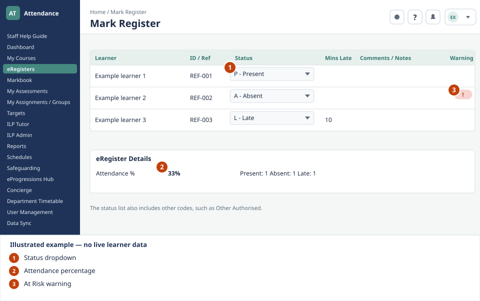
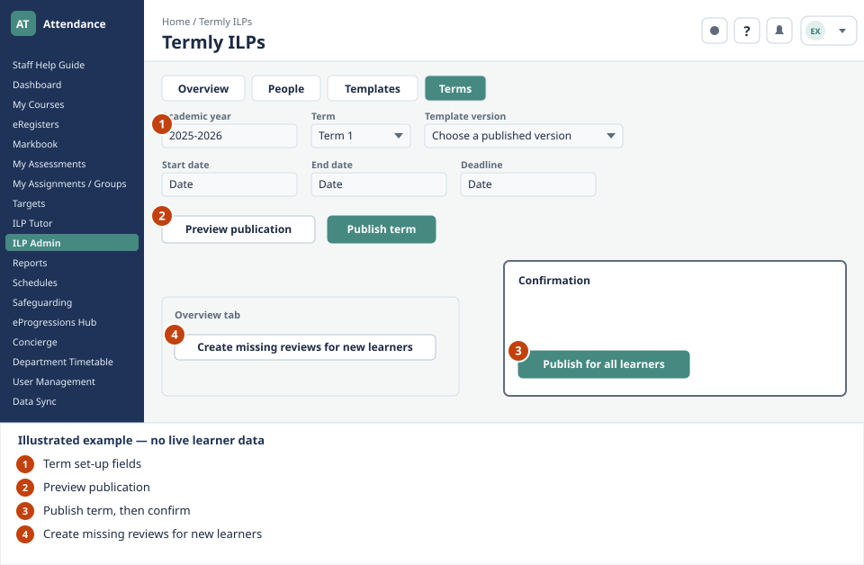

<div align="center">

# My School Attendance Manager

### Attendance, teaching workflows and learner reviews in one school portal.

A role-based learning hub for school staff, administrators and linked learners.


[Features](#features) · [Visual guide](#visual-guide) · [Development](#development) · [Project structure](#project-structure) · [Security](SECURITY.md)

</div>

---

## Overview

My School Attendance Manager brings together registers, course information, timetables and individual learning plan (ILP) reviews. Staff work within their assigned roles, while linked learners have a separate termly-review area.

The application uses a React frontend, an Express API and PostgreSQL. School-managed services provide directory information, password verification and Google Sheets synchronisation.

> **School-specific application:** this is not a public signup service or a ready-to-run demo with shared credentials. A working installation requires an authorised school directory, the school's authentication service and a configured database.

## Features

| Area | What it supports |
| --- | --- |
| **Attendance** | Lesson registers, attendance codes, late minutes, notes and register summaries. |
| **Courses** | Enrolled learners, course details, assessment plans and course reports. |
| **Timetables** | Personal and department views, lesson slots and print-friendly layouts. |
| **Teaching workflows** | Assessments, markbooks, targets and individual learning plans. |
| **Termly learner reviews** | Versioned templates, term publication, learner drafts and submission to assigned RG teachers. |
| **Administration** | Directory synchronisation, learner-account linking and role-based controls. |
| **Staff guidance** | A searchable, illustrated guide with 31 separate topic pages and full-size images. |

Features and editing controls depend on the signed-in user's role and assignments.

## Visual guide

These are **drawn training examples**, not live screenshots. All names, references and values shown are examples.

### Marking a register



### Opening a term for learner reviews



In the running portal, the **Help button beside notifications** opens the standalone staff guide in a new tab. Each topic includes a labelled illustration, instructions and an option to enlarge the image.

## Technology

- **Frontend:** React, TypeScript, Vite, Tailwind CSS and Radix UI.
- **API:** Express, TypeScript, Zod and an OpenAPI contract.
- **Database:** PostgreSQL with Drizzle ORM.
- **Workspace:** pnpm, shared libraries and generated API clients.
- **Guidance:** standalone HTML, CSS and SVG illustrations.

## Development

### Requirements

- Node.js 24 and pnpm.
- An authorised development PostgreSQL database.
- The school's directory and password-verification service configuration.
- A configured Google Sheets connection for synchronisation.
- Any storage configuration required for uploaded files.

Keep credentials in environment secrets. Do not place real passwords, connection strings or school records in source files or GitHub issues.

### Install

```sh
pnpm install --frozen-lockfile
```

### Configure

The API requires a development `DATABASE_URL` and `SESSION_SECRET`, together with the school-service configuration for the installation. The frontend requires `PORT` and `BASE_PATH`.

Do not use the production database for local development or synthetic integration fixtures.

### Start the services

Run these in separate terminals:

```sh
# API server
PORT=8080 pnpm --filter @workspace/api-server run dev
```

```sh
# Web frontend
PORT=22620 BASE_PATH=/ pnpm --filter @workspace/attendance-tracker run dev
```

The development setup also needs routing that forwards the frontend's API requests to the API service. The configured Replit workflows provide the project's preview routing; the frontend command alone does not configure a standalone reverse proxy.

### Checks

```sh
# Typecheck the workspace
pnpm run typecheck

# Frontend regression checks
pnpm --filter @workspace/attendance-tracker test

# API regression checks
pnpm --filter @workspace/api-server test

# Check that production build/startup commands do not mutate the database schema
node --test scripts/check-production-db-commands.test.mjs
node scripts/check-production-db-commands.mjs
```

Some integration and browser checks require an authorised development environment and dedicated test accounts. Do not run database-backed fixtures against production.

### Update the staff guide

```sh
node staff-guide/src/build.mjs
```

Guide text and illustration definitions live in `staff-guide/src/`. The generator writes the standalone topic pages and local SVG images. Authoring files are excluded from the public guide build.

## Project structure

```text
artifacts/
  attendance-tracker/   React web application
  api-server/           Express API and server checks
  mockup-sandbox/       Isolated design previews
lib/
  api-spec/             OpenAPI contract
  api-client-react/     Generated React API client
  api-zod/              Generated API validation
  db/                   Database schema and reviewed migrations
  replit-auth-web/      Shared authentication helpers
scripts/                Operational and production-safety checks
staff-guide/            Standalone illustrated staff guide
```

## Data and deployment safety

- Do not commit real learner records, safeguarding information, login sheets or unredacted school screenshots.
- Do not use shared learner accounts. Learner identities must be verified and linked to the correct school record.
- Review development schema changes before applying them.
- Production build and startup commands must not run schema pushes or migrations.
- Publishing the app is separate from uploading the source to GitHub.

See [SECURITY.md](SECURITY.md) for reporting and handling sensitive information.
